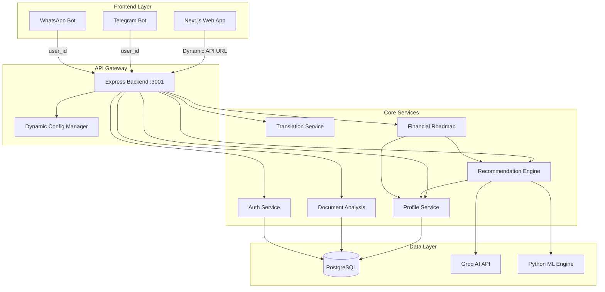
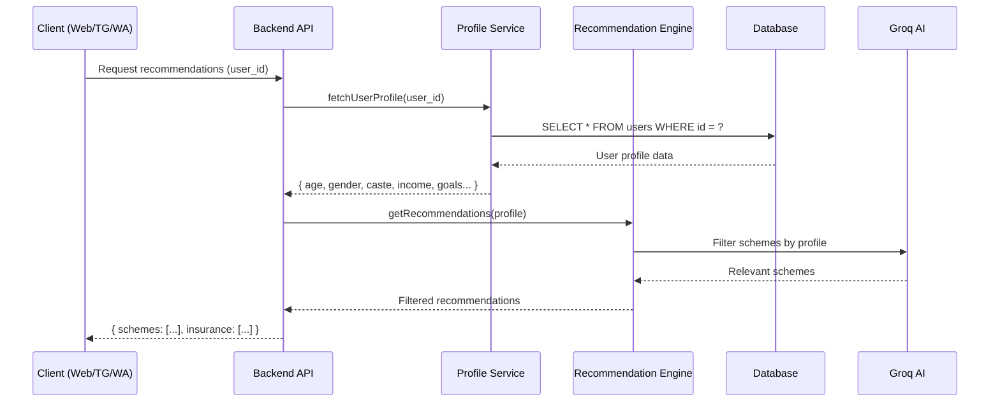
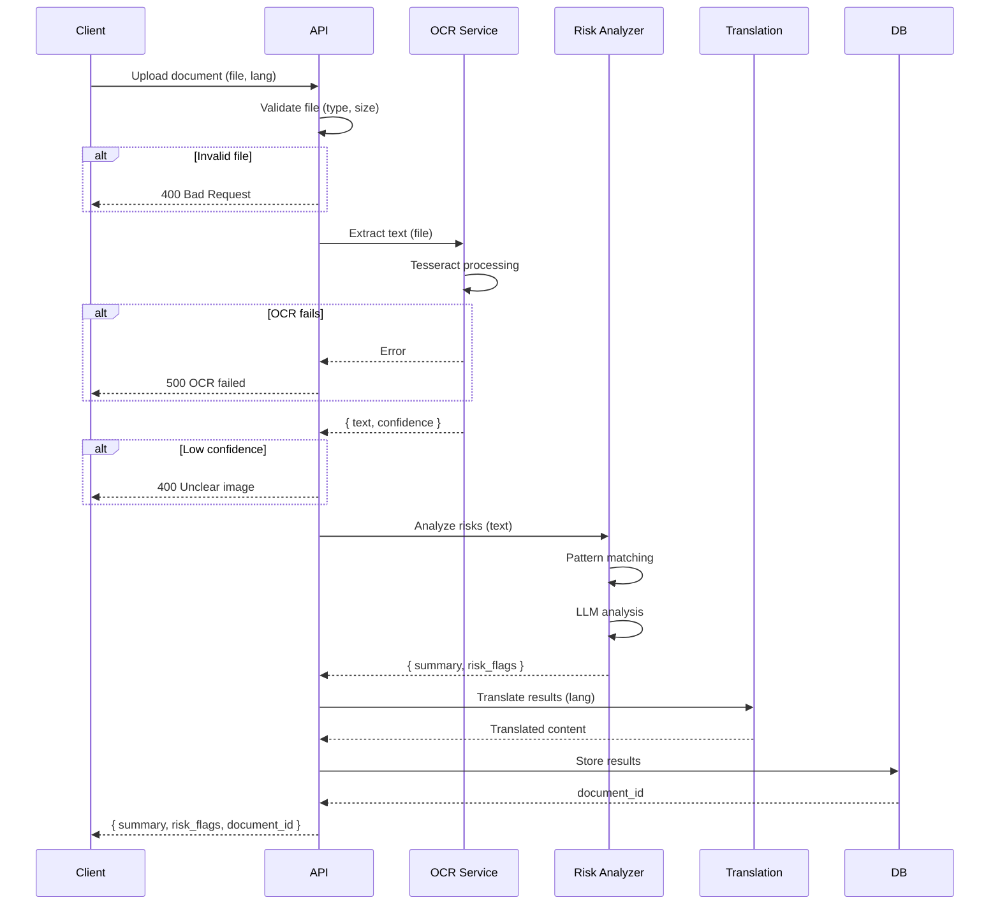

# Design Document: ArthSathi Critical Issues Resolution

## Overview

This design document provides comprehensive technical solutions for six critical issues in the ArthSathi application: authentication/API connectivity problems, broken document analysis, profile-ignorant recommendations across all platforms, incomplete multilingual support, missing financial roadmap feature, and excessive hardcoding. The design emphasizes profile-aware recommendations, dynamic configuration, and consistent user experience across web, Telegram, and WhatsApp platforms.

## Architecture

### High-Level System Architecture



### Sequence Diagram: Profile-Based Recommendation Flow



## Components and Interfaces

### Component 1: Dynamic API Configuration Manager

**Purpose**: Eliminates hardcoded API URLs and enables automatic environment detection

**Interface**:
```typescript
interface ConfigManager {
  getApiUrl(): string;
  getEnvironment(): 'development' | 'production' | 'staging';
  isClient(): boolean;
  refreshConfig(): void;
}
```

**Responsibilities**:
- Detect runtime environment (client vs server, development vs production)
- Provide correct API URL based on environment
- Support localhost, LAN IP, and production domains
- Cache configuration for performance

**Implementation Strategy**:
```typescript
// frontend/lib/config.ts
class ConfigManager {
  private static instance: ConfigManager;
  private apiUrl: string;
  
  private constructor() {
    // Client-side detection
    if (typeof window !== 'undefined') {
      // Check if running on localhost
      if (window.location.hostname === 'localhost' || 
          window.location.hostname === '127.0.0.1') {
        this.apiUrl = 'http://localhost:3001';
      } else {
        // Use environment variable for production
        this.apiUrl = process.env.NEXT_PUBLIC_API_URL || 'http://localhost:3001';
      }
    } else {
      // Server-side: always use localhost
      this.apiUrl = 'http://localhost:3001';
    }
  }
  
  static getInstance(): ConfigManager {
    if (!ConfigManager.instance) {
      ConfigManager.instance = new ConfigManager();
    }
    return ConfigManager.instance;
  }
  
  getApiUrl(): string {
    return this.apiUrl;
  }
}
```

### Component 2: Centralized Profile Service

**Purpose**: Single source of truth for user profile data across all services

**Interface**:
```typescript
interface ProfileService {
  fetchProfile(userId: string): Promise<UserProfile>;
  updateProfile(userId: string, updates: Partial<UserProfile>): Promise<void>;
  validateProfile(profile: UserProfile): ProfileValidation;
  isProfileComplete(userId: string): Promise<boolean>;
}

interface UserProfile {
  id: string;
  age: number;
  gender: 'male' | 'female' | 'transgender' | 'other';
  state: string;
  occupation: string;
  monthly_income: number;
  annual_income: number;
  caste_category: 'general' | 'obc' | 'sc' | 'st' | 'nt' | 'vjnt';
  bpl_card: boolean;
  is_disabled: boolean;
  disability_percent?: number;
  goals: string;
  preferred_language: 'hi' | 'en' | 'mr';
}

interface ProfileValidation {
  isValid: boolean;
  missingFields: string[];
  invalidFields: Record<string, string>;
}
```

**Responsibilities**:
- Fetch user profile from database
- Cache profile data with TTL
- Validate profile completeness
- Provide profile to all recommendation engines

### Component 3: Platform-Agnostic Recommendation Adapter

**Purpose**: Unified recommendation logic that works across web, Telegram, and WhatsApp

**Interface**:
```typescript
interface RecommendationAdapter {
  getSchemes(userId: string, limit?: number): Promise<Scheme[]>;
  getInsurance(userId: string, limit?: number): Promise<Insurance[]>;
  getRoadmap(userId: string): Promise<FinancialRoadmap>;
}

interface Scheme {
  id: string;
  name: string;
  description: string;
  category: string;
  ministry: string;
  benefit_value: number | null;
  application_url: string;
  eligibility_match_score: number;
}

interface Insurance {
  id: string;
  name: string;
  description: string;
  category: string;
  annual_premium: number;
  coverage_amount: number;
  coverage_type: string;
  application_url: string;
}

interface FinancialRoadmap {
  user_id: string;
  current_state: FinancialSnapshot;
  goals: Goal[];
  recommendations: {
    immediate_actions: Action[];
    short_term_plans: Action[];
    long_term_plans: Action[];
  };
  timeline: TimelineEvent[];
}
```

**Responsibilities**:
- Accept user_id from any platform
- Fetch user profile via ProfileService
- Call appropriate recommendation engine (Groq, ML, or fallback)
- Format results consistently for all platforms
- Log recommendation events for adaptive learning

### Component 4: Enhanced Document Analysis Pipeline

**Purpose**: Robust OCR and risk analysis with proper error handling

**Main Algorithm/Workflow**:



**Interface**:
```typescript
interface DocumentAnalyzer {
  analyze(file: Buffer, options: AnalysisOptions): Promise<AnalysisResult>;
  getRiskClauses(text: string): Promise<RiskClause[]>;
  summarize(text: string, language: string): Promise<string>;
}

interface AnalysisOptions {
  language: 'hi' | 'en' | 'mr';
  documentType?: 'insurance' | 'loan' | 'general';
  ocrEngine?: 'tesseract' | 'google_vision';
}

interface AnalysisResult {
  document_id: string;
  summary: string;
  raw_text: string;
  ocr_confidence: number;
  risk_flags: RiskClause[];
  risk_level: 'low' | 'medium' | 'high';
}

interface RiskClause {
  clause_text: string;
  risk_type: string;
  severity: 'low' | 'medium' | 'high';
  explanation: string;
  location: string;
}
```

### Component 5: Multilingual Content Manager

**Purpose**: Complete translation coverage across all UI elements

**Interface**:
```typescript
interface TranslationManager {
  translate(key: string, language: string, params?: Record<string, any>): string;
  translateBatch(keys: string[], language: string): Record<string, string>;
  loadNamespace(namespace: string, language: string): Promise<void>;
  getSupportedLanguages(): string[];
}

interface TranslationKey {
  namespace: string;  // 'common', 'schemes', 'dashboard', 'errors'
  key: string;
  defaultValue: string;
}
```

**Translation Namespaces**:
- `common`: Buttons, labels, navigation, form fields
- `schemes`: Scheme categories, eligibility criteria
- `insurance`: Policy types, coverage descriptions
- `dashboard`: Dashboard sections, stats, charts
- `errors`: Error messages, validation messages
- `roadmap`: Financial planning terms, goals
- `documents`: Document analysis, risk explanations

### Component 6: Financial Roadmap Generator

**Purpose**: Provide personalized financial planning based on user profile and goals

**Interface**:
```typescript
interface RoadmapGenerator {
  generate(userId: string): Promise<FinancialRoadmap>;
  updateGoal(userId: string, goalId: string, progress: number): Promise<void>;
  getActionItems(userId: string): Promise<Action[]>;
}

interface FinancialSnapshot {
  monthly_income: number;
  monthly_expenses: number;
  total_debts: number;
  total_savings: number;
  net_worth: number;
}

interface Goal {
  id: string;
  title: string;
  target_amount: number;
  current_amount: number;
  deadline: Date;
  priority: 'high' | 'medium' | 'low';
  category: 'education' | 'housing' | 'health' | 'business' | 'retirement';
}

interface Action {
  id: string;
  title: string;
  description: string;
  type: 'scheme_application' | 'insurance_purchase' | 'savings_plan' | 'debt_reduction';
  estimated_benefit: number;
  effort_level: 'low' | 'medium' | 'high';
  deadline: Date;
  status: 'pending' | 'in_progress' | 'completed';
  linked_entity_id?: string;  // scheme_id or insurance_id
}

interface TimelineEvent {
  date: Date;
  title: string;
  description: string;
  type: 'milestone' | 'action' | 'review';
}
```

## Data Models

### Configuration Model

```typescript
// frontend/lib/types/config.ts
interface AppConfig {
  apiUrl: string;
  environment: 'development' | 'production' | 'staging';
  features: {
    documentAnalysis: boolean;
    financialRoadmap: boolean;
    voiceSupport: boolean;
    multilingualSupport: boolean;
  };
  channels: {
    telegram: {
      enabled: boolean;
      botUsername: string;
    };
    whatsapp: {
      enabled: boolean;
      phoneNumber: string;
    };
    ivr: {
      enabled: boolean;
      phoneNumber: string;
    };
  };
  supportedLanguages: string[];
  defaultLanguage: string;
}
```

### Recommendation Request/Response Models

```typescript
// Consistent across all platforms
interface RecommendationRequest {
  user_id: string;
  limit?: number;
  include_applied?: boolean;
}

interface RecommendationResponse {
  success: boolean;
  source: 'groq' | 'engine' | 'fallback';
  data: Scheme[] | Insurance[];
  metadata: {
    total_matched: number;
    profile_completeness: number;
    missing_profile_fields: string[];
  };
}
```

### Document Analysis Models

```typescript
interface DocumentUpload {
  file: Buffer | File;
  filename: string;
  mimetype: string;
  language: 'hi' | 'en' | 'mr';
}

interface OCRResult {
  text: string;
  confidence: number;
  language_detected: string;
  processing_time_ms: number;
}

interface RiskAnalysisResult {
  summary: string;
  risk_level: 'low' | 'medium' | 'high';
  risk_flags: RiskClause[];
  recommendations: string[];
}
```

## Key Functions with Formal Specifications

### Function 1: fetchUserProfile()

```typescript
async function fetchUserProfile(userId: string): Promise<UserProfile>
```

**Preconditions:**
- `userId` is a valid UUID or numeric string
- Database connection is established
- `userId` exists in the users table

**Postconditions:**
- Returns complete UserProfile object
- Includes all fields from users and financial_profiles tables
- Profile data is fresh (not older than cache TTL)
- Throws `ProfileNotFoundError` if user doesn't exist

**Algorithm:**
```pascal
ALGORITHM fetchUserProfile(userId)
INPUT: userId (string)
OUTPUT: profile (UserProfile)

BEGIN
  // Check cache first
  cachedProfile ← cache.get("profile:" + userId)
  IF cachedProfile ≠ null AND NOT isExpired(cachedProfile) THEN
    RETURN cachedProfile
  END IF
  
  // Query database
  query ← "SELECT u.*, fp.* FROM users u 
           LEFT JOIN financial_profiles fp ON u.id = fp.user_id 
           WHERE u.id = ?"
  result ← database.execute(query, [userId])
  
  IF result.rows.length = 0 THEN
    THROW ProfileNotFoundError("User not found: " + userId)
  END IF
  
  profile ← mapRowToProfile(result.rows[0])
  
  // Cache for 5 minutes
  cache.set("profile:" + userId, profile, TTL=300)
  
  RETURN profile
END
```

### Function 2: getRelevantSchemes()

```typescript
async function getRelevantSchemes(userId: string, limit: number): Promise<Scheme[]>
```

**Preconditions:**
- `userId` is valid
- User profile exists and is complete
- `limit` is a positive integer ≤ 50

**Postconditions:**
- Returns array of schemes filtered by user's eligibility
- All returned schemes match user's age, income, caste, occupation, state
- Schemes are ranked by relevance score (highest first)
- Array length ≤ `limit`
- If no schemes match, returns empty array (not error)

**Algorithm:**
```pascal
ALGORITHM getRelevantSchemes(userId, limit)
INPUT: userId (string), limit (integer)
OUTPUT: schemes (Array<Scheme>)

BEGIN
  // Fetch user profile
  profile ← fetchUserProfile(userId)
  
  // Validate profile completeness
  IF NOT isProfileComplete(profile) THEN
    THROW IncompleteProfileError("Complete profile first", missingFields)
  END IF
  
  // Try Groq AI recommendation
  IF GROQ_API_KEY IS SET THEN
    TRY
      schemes ← groqService.getRelevantSchemes(profile, limit)
      RETURN schemes
    CATCH error
      LOG("Groq failed, falling back to ML engine")
    END TRY
  END IF
  
  // Try ML engine
  IF mlEngine.isHealthy() THEN
    TRY
      schemes ← mlEngine.recommend(profile, limit, "scheme")
      RETURN schemes
    CATCH error
      LOG("ML engine failed, using database fallback")
    END TRY
  END IF
  
  // Fallback: database filtering
  query ← buildEligibilityQuery(profile)
  schemes ← database.execute(query, profile, limit)
  
  RETURN schemes
END
```

### Function 3: analyzeDocument()

```typescript
async function analyzeDocument(
  file: Buffer,
  language: string
): Promise<AnalysisResult>
```

**Preconditions:**
- `file` is a valid image or PDF buffer
- File size ≤ 10MB
- `language` is one of: 'hi', 'en', 'mr'
- OCR service is available

**Postconditions:**
- Returns AnalysisResult with summary and risk flags
- If OCR confidence < 60%, throws `LowConfidenceError`
- All risk_flags contain explanation in requested language
- Document is saved to database with generated document_id
- Processing time logged for monitoring

**Algorithm:**
```pascal
ALGORITHM analyzeDocument(file, language)
INPUT: file (Buffer), language (string)
OUTPUT: result (AnalysisResult)

BEGIN
  // Validate file
  IF file.size > 10_485_760 THEN  // 10MB
    THROW FileTooLargeError("Max 10MB")
  END IF
  
  IF NOT isValidImageOrPDF(file) THEN
    THROW InvalidFileTypeError("Must be image or PDF")
  END IF
  
  // OCR extraction
  startTime ← NOW()
  ocrResult ← tesseractService.extractText(file, language)
  
  IF ocrResult.confidence < 60 THEN
    THROW LowConfidenceError("Image quality too low. Send clearer photo.")
  END IF
  
  // Risk analysis
  riskFlags ← []
  patterns ← getRiskPatterns()
  
  FOR EACH pattern IN patterns DO
    IF pattern.matches(ocrResult.text) THEN
      flag ← {
        clause_text: extractClause(ocrResult.text, pattern),
        risk_type: pattern.type,
        severity: pattern.severity,
        explanation: pattern.explanation[language]
      }
      riskFlags.push(flag)
    END IF
  END FOR
  
  // LLM-based analysis for complex risks
  IF llmService.isAvailable() THEN
    llmRisks ← llmService.analyzeRisks(ocrResult.text)
    FOR EACH risk IN llmRisks DO
      risk.explanation ← translate(risk.explanation, language)
      riskFlags.push(risk)
    END FOR
  END IF
  
  // Generate summary
  summary ← llmService.summarize(ocrResult.text, language)
  
  // Determine overall risk level
  highCount ← COUNT(riskFlags WHERE severity = "high")
  mediumCount ← COUNT(riskFlags WHERE severity = "medium")
  
  IF highCount > 0 THEN
    overallRisk ← "high"
  ELSE IF mediumCount > 2 THEN
    overallRisk ← "medium"
  ELSE
    overallRisk ← "low"
  END IF
  
  // Save to database
  documentId ← database.insert("documents", {
    raw_ocr_text: ocrResult.text,
    ocr_confidence: ocrResult.confidence,
    summary_text: summary,
    risk_flags: JSON.stringify(riskFlags),
    risk_level: overallRisk,
    processed_at: NOW()
  })
  
  processingTime ← NOW() - startTime
  LOG("Document analyzed in " + processingTime + "ms")
  
  RETURN {
    document_id: documentId,
    summary: summary,
    raw_text: ocrResult.text,
    ocr_confidence: ocrResult.confidence,
    risk_flags: riskFlags,
    risk_level: overallRisk
  }
END
```

### Function 4: generateFinancialRoadmap()

```typescript
async function generateFinancialRoadmap(userId: string): Promise<FinancialRoadmap>
```

**Preconditions:**
- User profile exists and is complete
- User has set at least one financial goal
- User has monthly_income and monthly_expenses data

**Postconditions:**
- Returns comprehensive roadmap with timeline
- All recommendations are based on user's actual eligibility
- Timeline spans from current date to furthest goal deadline
- Action items are prioritized by impact and feasibility

**Algorithm:**
```pascal
ALGORITHM generateFinancialRoadmap(userId)
INPUT: userId (string)
OUTPUT: roadmap (FinancialRoadmap)

BEGIN
  // Fetch user profile and financial data
  profile ← fetchUserProfile(userId)
  
  IF profile.monthly_income IS NULL THEN
    THROW IncompleteProfileError("Income data required")
  END IF
  
  // Calculate current financial state
  currentState ← {
    monthly_income: profile.monthly_income,
    monthly_expenses: estimateExpenses(profile),
    total_debts: profile.total_debts,
    total_savings: calculateSavings(profile),
    net_worth: calculateNetWorth(profile)
  }
  
  monthlyDisposable ← currentState.monthly_income - currentState.monthly_expenses
  
  // Get user goals from profile
  goals ← parseGoals(profile.goals)
  
  // Get eligible schemes and insurance
  eligibleSchemes ← getRelevantSchemes(userId, 20)
  eligibleInsurance ← getRelevantInsurance(userId, 10)
  
  // Generate immediate actions (0-3 months)
  immediateActions ← []
  
  // Action: Apply for high-benefit schemes
  FOR EACH scheme IN eligibleSchemes WHERE scheme.benefit_value > 10000 DO
    immediateActions.push({
      title: "Apply for " + scheme.name,
      type: "scheme_application",
      estimated_benefit: scheme.benefit_value,
      effort_level: "medium",
      deadline: NOW() + 30 days,
      linked_entity_id: scheme.id
    })
  END FOR
  
  // Action: Get essential insurance if missing
  IF profile.has_life_insurance = FALSE THEN
    pmjjby ← FIND(eligibleInsurance WHERE name LIKE "PMJJBY")
    IF pmjjby IS NOT NULL THEN
      immediateActions.push({
        title: "Get life insurance (PMJJBY)",
        type: "insurance_purchase",
        estimated_benefit: 200000,  // coverage amount
        effort_level: "low",
        deadline: NOW() + 15 days,
        linked_entity_id: pmjjby.id
      })
    END IF
  END IF
  
  // Short-term actions (3-12 months)
  shortTermActions ← []
  
  IF monthlyDisposable > 1000 THEN
    shortTermActions.push({
      title: "Start emergency fund (₹" + (monthlyDisposable * 6) + ")",
      type: "savings_plan",
      estimated_benefit: monthlyDisposable * 6,
      effort_level: "low",
      deadline: NOW() + 180 days
    })
  END IF
  
  // Long-term actions (1+ years)
  longTermActions ← []
  
  FOR EACH goal IN goals DO
    monthsToGoal ← MONTHS_BETWEEN(NOW(), goal.deadline)
    monthlyRequired ← (goal.target_amount - goal.current_amount) / monthsToGoal
    
    longTermActions.push({
      title: "Save for " + goal.title,
      type: "savings_plan",
      estimated_benefit: goal.target_amount,
      effort_level: monthlyRequired > monthlyDisposable ? "high" : "medium",
      deadline: goal.deadline
    })
  END FOR
  
  // Build timeline
  timeline ← []
  allActions ← immediateActions + shortTermActions + longTermActions
  
  FOR EACH action IN allActions DO
    timeline.push({
      date: action.deadline,
      title: action.title,
      type: "action"
    })
  END FOR
  
  // Add milestone events
  IF goals.length > 0 THEN
    FOR EACH goal IN goals DO
      timeline.push({
        date: goal.deadline,
        title: goal.title + " target date",
        type: "milestone"
      })
    END FOR
  END IF
  
  // Sort timeline by date
  timeline ← SORT(timeline BY date ASC)
  
  RETURN {
    user_id: userId,
    current_state: currentState,
    goals: goals,
    recommendations: {
      immediate_actions: immediateActions,
      short_term_plans: shortTermActions,
      long_term_plans: longTermActions
    },
    timeline: timeline
  }
END
```

## Correctness Properties

### Property 1: Profile-based filtering consistency

*For any* user profile P and recommendation request R, all returned schemes and insurance policies SHALL match the user's eligibility criteria (age, income, caste, occupation, state, disability status)

**Validates: Requirements 3.1, 3.2, 3.3**

### Property 2: API URL resolution correctness

*For any* frontend environment E (localhost, LAN, production), the API URL SHALL resolve to a reachable backend endpoint without hardcoded IP addresses

**Validates: Requirements 1.1, 1.2**

### Property 3: Document analysis completeness

*For any* valid document D uploaded with language L, the analysis result SHALL contain summary and risk flags translated to language L, or SHALL fail with a clear error message

**Validates: Requirements 2.1, 2.2**

### Property 4: Translation coverage

*For any* UI element U and supported language L, there SHALL exist a translation in the i18n system for L, with no untranslated English text visible to users

**Validates: Requirements 4.1, 4.2**

### Property 5: User identity preservation

*For any* platform (web, Telegram, WhatsApp) and user U, the user_id used for recommendations SHALL be the actual authenticated user's ID, never a hardcoded test ID

**Validates: Requirements 3.4, 3.5**

### Property 6: Roadmap feasibility

*For any* generated financial roadmap R for user U, all recommended schemes and insurance in R SHALL be schemes/policies that U is actually eligible for based on profile

**Validates: Requirements 5.1, 5.2**

### Property 7: Configuration consistency

*For any* configuration value V used in the application, V SHALL be sourced from environment variables or database, not hardcoded in source files

**Validates: Requirements 6.1, 6.2**

### Property 8: Error handling robustness

*For any* service call that fails (Groq, ML engine, OCR), the system SHALL fall back to an alternative approach or return a user-friendly error, never crash or return undefined

**Validates: Requirements 1.3, 2.3**

## Error Handling

### Error Scenario 1: Backend Unreachable

**Condition**: Frontend cannot connect to backend API
**Response**: 
- Display connection error modal with retry button
- Show user's cached data if available
- Suggest checking internet connection
- Log error to monitoring service
**Recovery**: 
- Implement exponential backoff retry (1s, 2s, 4s, 8s)
- Switch to offline mode showing cached schemes/insurance
- Notify user when connection restored

### Error Scenario 2: Incomplete User Profile

**Condition**: User requests recommendations but profile is missing required fields
**Response**:
- Return 400 Bad Request with specific missing fields
- Frontend shows profile completion modal
- Highlight missing fields in form
**Recovery**:
- Guide user to complete profile
- Allow partial recommendations if only minor fields missing
- Save partial profile progress

### Error Scenario 3: Document OCR Failure

**Condition**: Tesseract cannot extract text or confidence < 60%
**Response**:
- Return 400 error with message "Image quality too low"
- Provide tips: better lighting, focus, contrast
- Suggest alternative: type document details manually
**Recovery**:
- Offer to retry with different OCR settings
- Allow user to provide document type for optimized processing
- Fall back to manual data entry form

### Error Scenario 4: Groq API Rate Limit

**Condition**: Groq API returns 429 Too Many Requests
**Response**:
- Log rate limit event
- Immediately fall back to ML engine or database filtering
- No user-visible error
**Recovery**:
- Continue serving recommendations from fallback
- Implement request queuing for Groq calls
- Monitor rate limits and adjust request frequency

### Error Scenario 5: Translation Service Unavailable

**Condition**: Translation API fails or times out
**Response**:
- Fall back to English content
- Show language switch warning: "Translation temporarily unavailable"
- Log translation failure
**Recovery**:
- Retry translation in background
- Use cached translations if available
- Queue failed translations for retry

### Error Scenario 6: Database Connection Lost

**Condition**: PostgreSQL connection fails mid-request
**Response**:
- Return 503 Service Unavailable
- Log critical error to monitoring
- Show maintenance page to users
**Recovery**:
- Implement connection pooling with auto-reconnect
- Retry query up to 3 times with backoff
- Alert DevOps team for manual intervention if needed

## Testing Strategy

### Unit Testing Approach

**Coverage Goals**: 80% code coverage for core services

**Key Unit Test Suites**:

1. **ProfileService Tests**
   - Test fetchUserProfile with valid/invalid user IDs
   - Test profile caching behavior
   - Test profile validation logic
   - Mock database queries

2. **ConfigManager Tests**
   - Test API URL detection in different environments
   - Test localhost vs LAN vs production detection
   - Mock window.location and process.env

3. **RecommendationAdapter Tests**
   - Test scheme filtering logic with various profiles
   - Test insurance filtering by age, income constraints
   - Test fallback chain: Groq → ML → Database
   - Mock external service calls

4. **DocumentAnalyzer Tests**
   - Test OCR text extraction
   - Test risk pattern matching
   - Test translation of analysis results
   - Mock Tesseract and LLM services

5. **TranslationManager Tests**
   - Test key lookups in all languages
   - Test missing key fallbacks
   - Test parameter interpolation
   - Mock i18n backend

### Property-Based Testing Approach

**Property Test Library**: fast-check (JavaScript/TypeScript)

**Property Tests**:

1. **Property: Profile eligibility filtering**
   - Generate random user profiles
   - For each profile, get scheme recommendations
   - Assert: All schemes match profile constraints (age range, income range, caste, state)
   - 100+ random profiles per test run

2. **Property: API URL consistency**
   - Generate random environment configurations
   - For each config, get API URL
   - Assert: URL is always valid HTTP(S) URL
   - Assert: Localhost URLs only for development
   - 50+ environment variations

3. **Property: Translation completeness**
   - Generate list of all UI keys
   - For each key and each language
   - Assert: Translation exists and is non-empty
   - Assert: No English text in non-English translations

4. **Property: Roadmap timeline ordering**
   - Generate random user goals and deadlines
   - Generate roadmap
   - Assert: Timeline events are sorted chronologically
   - Assert: All action deadlines are in the future

### Integration Testing Approach

**Integration Test Scenarios**:

1. **End-to-End Recommendation Flow**
   - Create test user with complete profile
   - Request schemes via web API
   - Request schemes via Telegram bot
   - Request schemes via WhatsApp bot
   - Assert: All three return same schemes (proving profile-based logic)

2. **Document Upload Pipeline**
   - Upload test insurance document (English)
   - Upload test loan document (Hindi)
   - Assert: Both return analysis with correct language
   - Assert: Risk flags are detected and translated

3. **Language Switching**
   - Load dashboard in English
   - Switch to Hindi
   - Switch to Marathi
   - Assert: All text elements update correctly
   - Assert: No English remnants in Hindi/Marathi

4. **Financial Roadmap Generation**
   - Create user with goals
   - Generate roadmap
   - Assert: Recommendations match user eligibility
   - Assert: Timeline includes all goals
   - Assert: Actions are prioritized correctly

## Performance Considerations

### Database Query Optimization

**Issue**: Recommendation queries can be slow with complex eligibility filters

**Solution**:
- Add composite indexes on schemes table: (is_active, category, min_age, max_age)
- Add GIN indexes for array columns: eligible_states, tags
- Implement query result caching with Redis (TTL 15 minutes)
- Use EXPLAIN ANALYZE to identify slow queries

### API Response Caching

**Strategy**:
- Cache user profiles: 5 minutes
- Cache scheme lists: 15 minutes
- Cache recommendations: 1 minute (user-specific)
- Cache translations: 1 hour

**Implementation**:
```typescript
interface CacheStrategy {
  key: string;
  ttl: number;  // seconds
  invalidation: 'time' | 'event' | 'manual';
}

const cacheStrategies: Record<string, CacheStrategy> = {
  userProfile: { key: 'profile:{userId}', ttl: 300, invalidation: 'event' },
  schemes: { key: 'schemes:all', ttl: 900, invalidation: 'time' },
  recommendations: { key: 'rec:{userId}:{type}', ttl: 60, invalidation: 'time' },
  translations: { key: 'i18n:{lang}:{ns}', ttl: 3600, invalidation: 'manual' }
};
```

### Frontend Optimization

**Lazy Loading**:
- Load recommendation components only when needed
- Load document analysis only on /documents page
- Load financial roadmap only when requested

**Image Optimization**:
- Compress uploaded documents before sending
- Resize images on client side (max 2MB)
- Use WebP format where supported

**Bundle Splitting**:
- Separate bundles for each major feature
- Load translations on demand per language
- Tree-shake unused i18n keys

## Security Considerations

### Authentication & Authorization

**Issue**: Prevent unauthorized access to user data

**Measures**:
- JWT tokens with 24-hour expiration
- Verify user_id in every API request
- Never trust client-provided user_id without token validation
- Rate limit API calls per user: 100 requests/hour

### Data Privacy

**Issue**: Protect sensitive user information (Aadhaar, income, medical data)

**Measures**:
- Store Aadhaar as SHA-256 hash only (never plaintext)
- Encrypt financial_profiles table at rest
- Redact sensitive fields in logs
- Implement GDPR-compliant data deletion

### Telegram/WhatsApp Security

**Issue**: Verify bot messages are from legitimate users

**Measures**:
- Validate Telegram user ID signature
- Use WhatsApp webhook verification
- Implement /link command to connect phone with Telegram ID
- Rate limit bot commands: 10 per minute per user

### Document Upload Security

**Issue**: Prevent malicious file uploads

**Measures**:
- Whitelist MIME types: image/*, application/pdf only
- Scan uploaded files for malware
- Limit file size: 10MB maximum
- Store uploads outside web root
- Generate random filenames to prevent guessing

## Dependencies

### Backend Dependencies

**Core Framework**:
- `express` (v4.18+): API server
- `pg` (v8.11+): PostgreSQL client
- `cors`: Cross-origin request handling

**AI Services**:
- `groq-sdk` (v0.1+): Groq AI integration
- `axios`: HTTP client for ML engine

**Document Processing**:
- `tesseract.js` (v4.0+): OCR engine
- `multer`: File upload handling
- `sharp`: Image preprocessing

**Utilities**:
- `dotenv`: Environment configuration
- `jsonwebtoken`: JWT token handling
- `bcrypt`: Password hashing

### Frontend Dependencies

**Core Framework**:
- `next` (v14+): React framework
- `react` (v18+): UI library
- `typescript` (v5+): Type safety

**UI Components**:
- `@radix-ui/*`: Accessible components
- `tailwindcss` (v3+): Styling
- `lucide-react`: Icons

**Internationalization**:
- `next-i18next` (v15+): i18n framework
- `react-i18next` (v13+): React i18n bindings

**State Management**:
- `zustand` or `jotai`: Lightweight state
- `react-query`: Server state caching

**API Client**:
- `axios` or `fetch`: HTTP requests

### Bot Dependencies

**Telegram**:
- `grammy` (v1.19+): Telegram bot framework

**WhatsApp**:
- `whatsapp-web.js` or Twilio API

**Shared**:
- `axios`: API communication
- `form-data`: File uploads

### External Services

**Required**:
- PostgreSQL 14+: Primary database
- Groq API: AI recommendations (optional but recommended)

**Optional**:
- Python ML Engine: Advanced recommendations
- Redis: Caching layer (recommended for production)
- Sentry: Error monitoring
- Google Cloud Vision: Alternative OCR engine

### Development Dependencies

**Testing**:
- `jest`: Test runner
- `@testing-library/react`: React testing
- `@testing-library/jest-dom`: DOM assertions
- `fast-check`: Property-based testing

**Code Quality**:
- `eslint`: Linting
- `prettier`: Code formatting
- `husky`: Git hooks
- `lint-staged`: Pre-commit checks

**Build Tools**:
- `tsup` or `webpack`: Bundling
- `nodemon`: Development server
